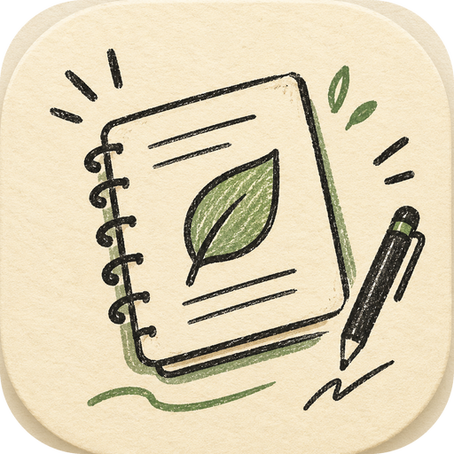
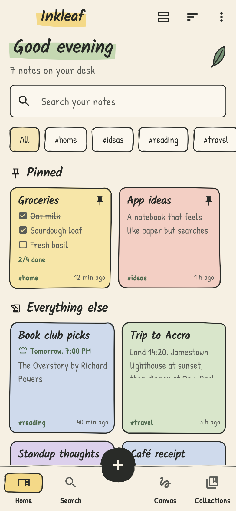
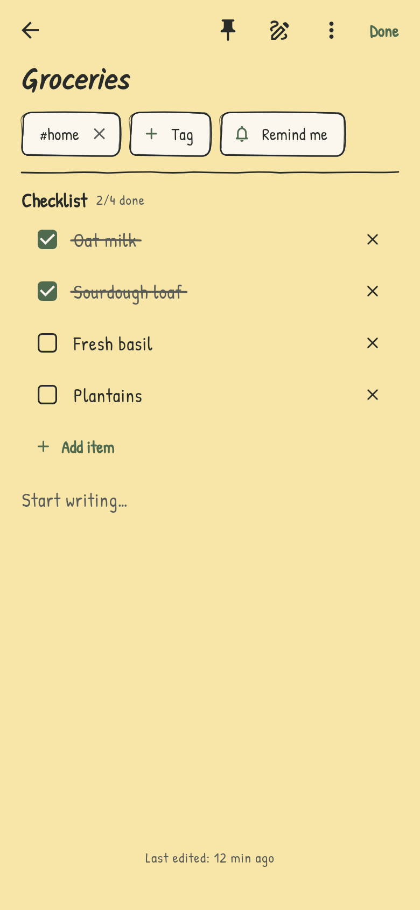
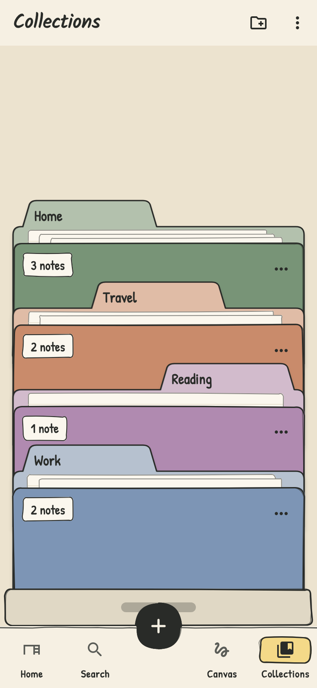
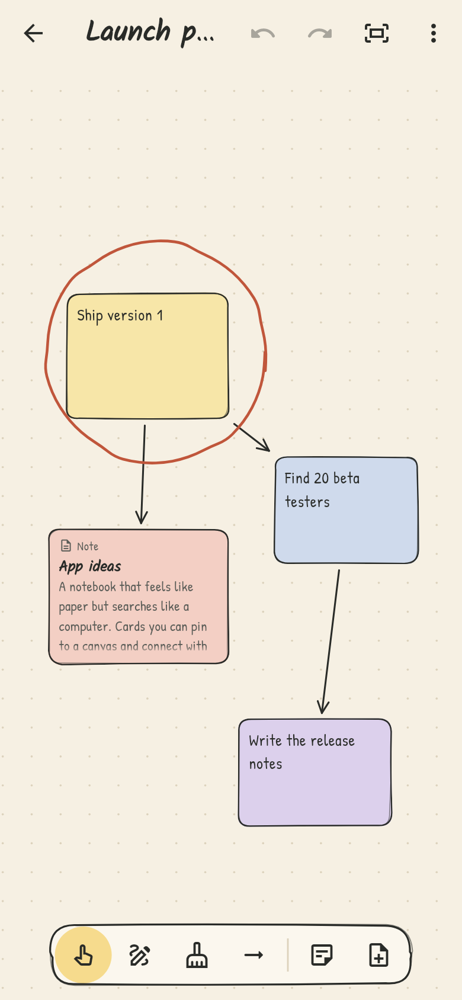
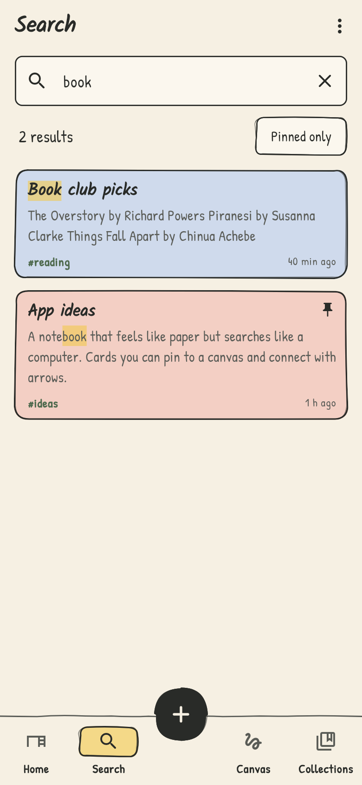
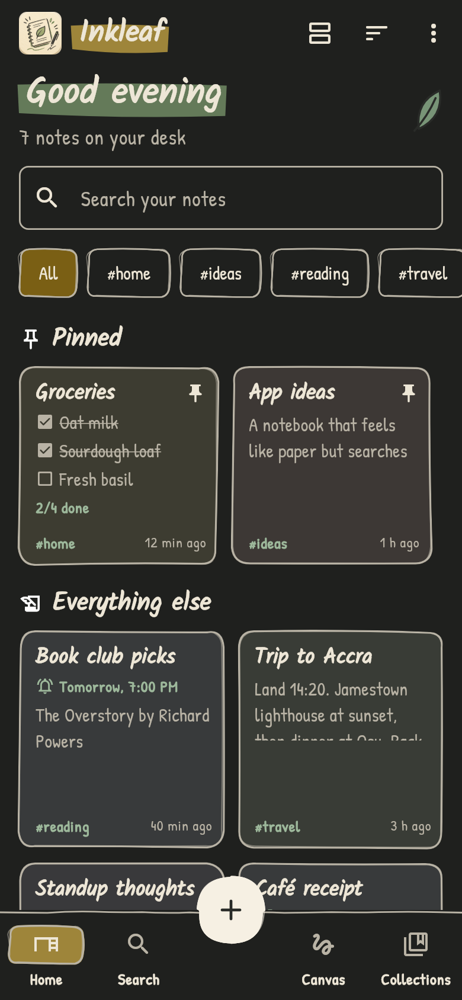
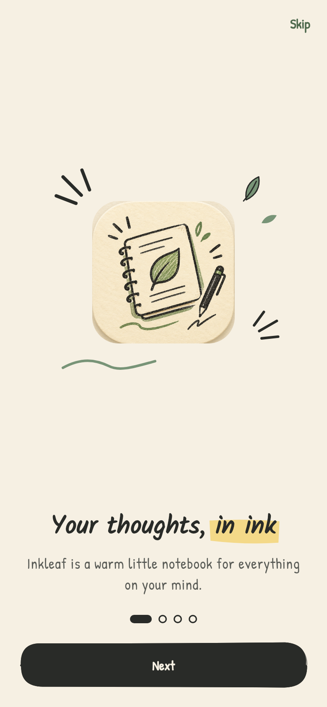
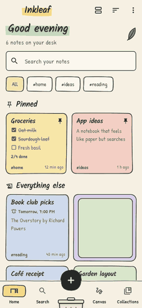

<p align="center">
  
</p>

<h1 align="center">Inkleaf</h1>

<p align="center"><em>Your thoughts, in ink.</em></p>

<p align="center">
  A warm, hand-drawn notebook for Android and iOS. Write, sketch, record and
  scan; gather notes into folders and lay ideas out on a canvas; find
  anything again in seconds. Everything stays on your phone.
</p>

<p align="center">
  
  
  
  
</p>

---

## Features

**Write and capture**
- **Notes** with titles, tags, colors and pinning. Changes save as you type.
- **Formatting**: headings, **bold**, *italic*, ~~strike~~ and lists, drawn
  as you type, with a toolbar above the keyboard.
- **Templates**: start a daily journal, meeting notes, packing list, recipe
  or to-do from the + menu.
- **Checklists**: tick items off with a pencil strike-through; cards show
  progress like "2/4 done".
- **Sketches**: draw on a full-screen pad with pens, colors and an eraser.
- **Voice notes**: record with a live level meter; play back with seeking.
- **Scan pages**: photograph a page or receipt and the text is read on the
  phone (ML Kit), ready to fix up and search. The photo is kept with the note.
- **Share into Inkleaf**: text, links and photos shared from any app become
  a new note (Android).
- **Home-screen widget**: one-tap note, checklist, voice note or scan, plus
  your pinned notes, right on the phone's home screen (Android).

**Organize**
- **Links between notes**: type `[[` to link another note; each note shows
  what it links to and what links back to it.
- **Collections**: notebooks shown as folders in an open drawer. Drag to
  reorder; a note can live in several.
- **Canvas**: put sticky notes and your notes on a board, connect them with
  arrows and draw around them. Pan, zoom, undo and redo.
- **Reminders**: pick a time on any note and get a notification, even with
  the app closed. Tapping it opens the note.

**Find it again**
- **Search** across titles, text, checklist items and tags (`#travel`), with
  matches highlighted and recent searches remembered.

**Keep it safe**
- **App lock**: fingerprint, face or PIN to open Inkleaf.
- **Local first**: a SQLite database on the device; no account or internet
  needed.
- **Backup and restore**: export everything, including recordings and scans,
  as one `.zip`. Restoring merges and never overwrites newer work.
- **Trash** with undo, and a 3-second undo after every delete.

## A closer look

<table>
  <tr>
    <td align="center" width="25%">
      <br>
      <sub><b>Search</b>: matches highlighted in titles, text and tags</sub>
    </td>
    <td align="center" width="25%">
      <br>
      <sub><b>Night</b>: a dark "night desk" theme, or follow the system</sub>
    </td>
    <td align="center" width="25%">
      <br>
      <sub><b>Onboarding</b>: a short hand-drawn intro on first launch</sub>
    </td>
    <td align="center" width="25%">
      <br>
      <sub><b>Delete</b>: notes fold, crumple and land in the bin</sub>
    </td>
  </tr>
</table>

## Design

Inkleaf aims to feel like a physical sketchbook: cream paper, charcoal ink,
pencil outlines and small doodles, with the speed of a digital tool.

| Role | Color | Hex |
|---|---|---|
| Paper | Warm cream | `#F6F0E3` |
| Ink | Soft charcoal | `#292B28` |
| Accent | Sage green | `#789477` |
| Highlight | Pencil yellow | `#E8C875` |

- **Type:** [Kalam](https://fonts.google.com/specimen/Kalam) for headings and
  [Patrick Hand](https://fonts.google.com/specimen/Patrick+Hand) for text,
  bundled with the app so they work offline.
- **Shapes:** slightly wobbly double "pencil" outlines (`SketchBorder`),
  marker highlights (`MarkerHighlight`) and hand-drawn dividers.
- **Motion with a purpose:** the folder drawer, the bin, pencil
  strike-throughs and cards that travel when pinned. Every animation is
  skipped when the phone's reduce-motion setting is on.
- **Accessibility:** 48px touch targets, readable contrast in both themes,
  and screen-reader labels on custom controls.

## Getting started

Requirements: Flutter 3.47 (stable) with Dart 3.13 or newer, and the Android
SDK. iOS builds need a Mac with Xcode.

```bash
git clone https://github.com/Qharny/InkLeaf.git
cd InkLeaf
flutter pub get
flutter run --release   # debug builds are much slower than the real app
```

### Platform notes

- **Android:** asks for the microphone (voice notes) and notifications
  (reminders) when first used. Exact reminder timing uses the "Alarms &
  reminders" permission where Android allows it; otherwise reminders may
  arrive a few minutes late.
- **iOS:** text recognition needs iOS 15.5 or newer. On your first iOS
  build, set `platform :ios, '15.5'` in the generated `ios/Podfile`. Sharing
  into Inkleaf needs a Share Extension target, which isn't set up yet.

### Checks

```bash
flutter analyze
flutter test
```

GitHub Actions runs the same checks (plus `dart format`) on every pull
request.

### Screenshots

The images above are rendered from the real app with sample notes:

```bash
flutter test tool/take_screenshots.dart
```

This writes the PNGs to `docs/screenshots/` and the delete animation's frames
to `build/screenshots/bin_frames/`.

### Regenerating the app icon and splash

After changing the images in `assets/icon/`:

```bash
dart run flutter_launcher_icons
dart run flutter_native_splash:create
```

## Project structure

```
lib/
├── app/                  # App, router (go_router), shell, theme
├── core/
│   ├── navigation/       # Opening a note from a share or a reminder
│   ├── storage/          # SQLite database, settings, media files
│   ├── utils/            # Dates and durations
│   └── widgets/          # Logo, doodles, dialogs
└── features/
    ├── home/             # The desk: pinned, recent, search, tags
    ├── notes/            # Note model, editor, checklists, sketches, trash
    ├── search/           # Ranked search with highlights
    ├── collections/      # Folder drawer and collection pages
    ├── canvas/           # Boards with cards, arrows and drawing
    ├── record/           # Voice notes
    ├── scan/             # Camera + on-device text recognition
    ├── reminders/        # Scheduled notifications
    ├── share/            # Receiving shares from other apps
    ├── backup/           # Zip export and merge-restore
    ├── settings/
    ├── onboarding/
    └── splash/
```

Each feature keeps its data (`data/`), models (`domain/`) and screens
(`presentation/`) together. Platform services (microphone, camera,
notifications, sharing) sit behind small interfaces so tests can use fakes.

## Tech stack

| Area | Choice |
|---|---|
| Framework | Flutter + Dart |
| Routing | [go_router](https://pub.dev/packages/go_router) |
| Storage | [sqlite3](https://pub.dev/packages/sqlite3), [shared_preferences](https://pub.dev/packages/shared_preferences) (settings) |
| Voice notes | [record](https://pub.dev/packages/record), [audioplayers](https://pub.dev/packages/audioplayers) |
| Scanning | [image_picker](https://pub.dev/packages/image_picker), [google_mlkit_text_recognition](https://pub.dev/packages/google_mlkit_text_recognition) |
| Reminders | [flutter_local_notifications](https://pub.dev/packages/flutter_local_notifications), [timezone](https://pub.dev/packages/timezone), [flutter_timezone](https://pub.dev/packages/flutter_timezone) |
| Backup | [archive](https://pub.dev/packages/archive), [share_plus](https://pub.dev/packages/share_plus), [file_picker](https://pub.dev/packages/file_picker) |
| Sharing in | [receive_sharing_intent](https://pub.dev/packages/receive_sharing_intent) |
| App lock | [local_auth](https://pub.dev/packages/local_auth) |
| Home-screen widget | [home_widget](https://pub.dev/packages/home_widget) |
| Fonts | [google_fonts](https://pub.dev/packages/google_fonts) with bundled font files |

## License

[MIT](LICENSE) © 2026 Manasseh Kabutey. The bundled Kalam and Patrick Hand
fonts are under the SIL Open Font License (see `assets/google_fonts/`).

Built by [Qharny](https://github.com/Qharny).
